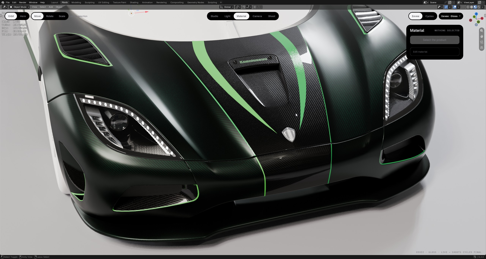
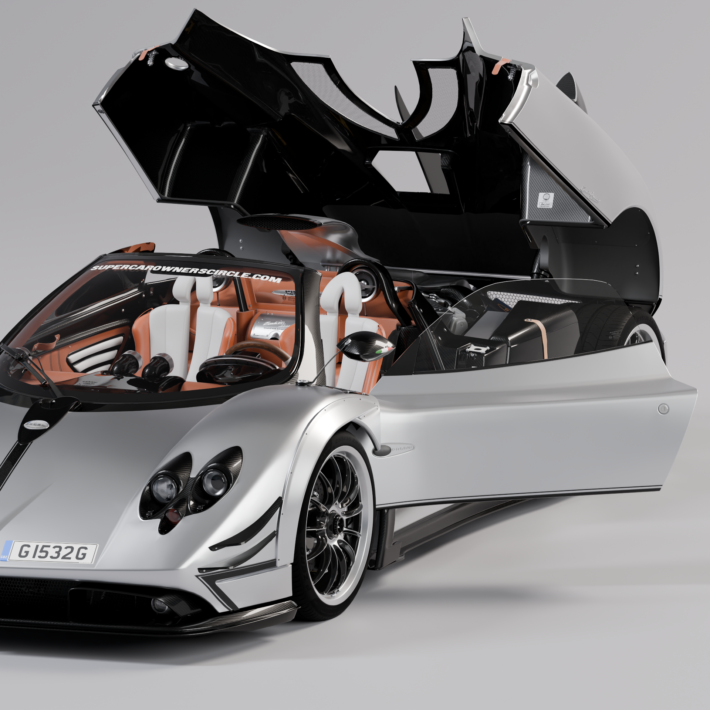
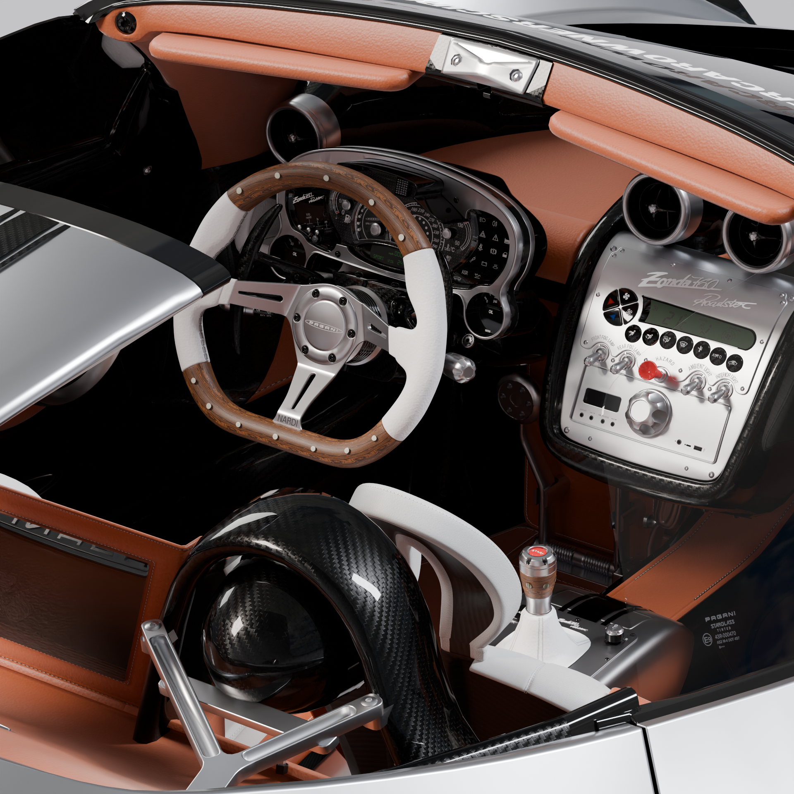
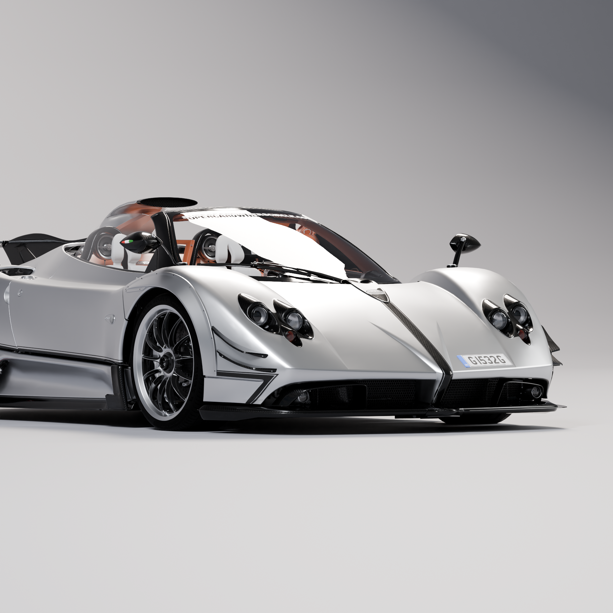
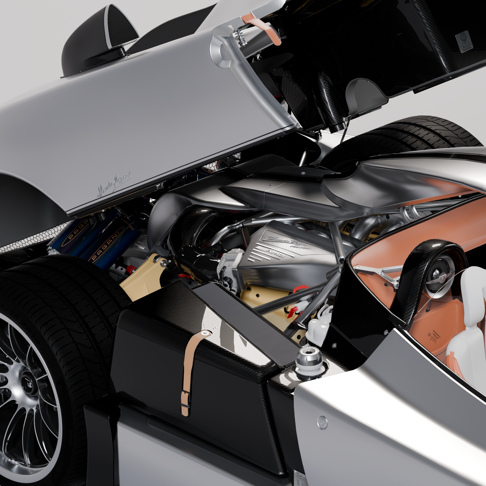
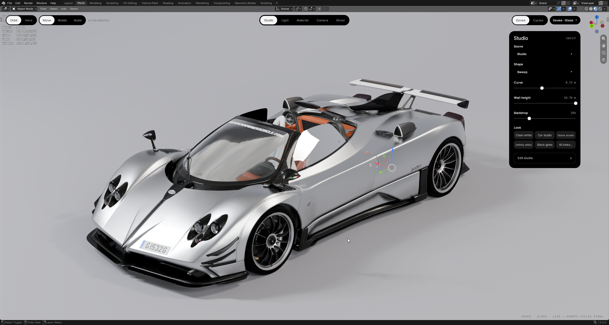
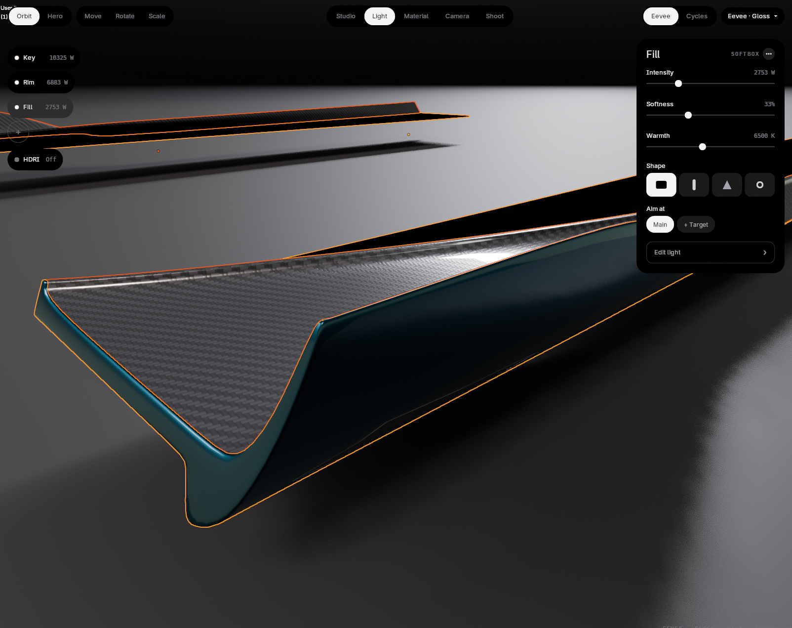
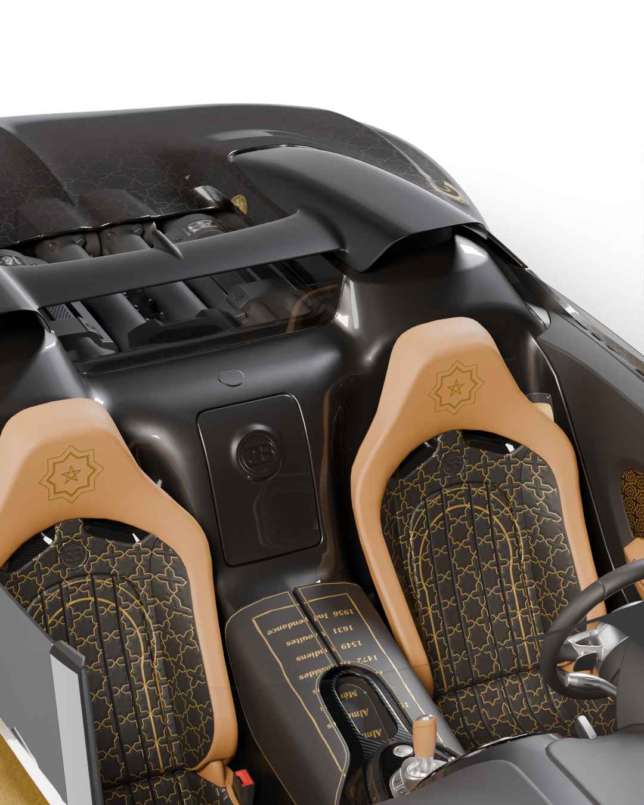
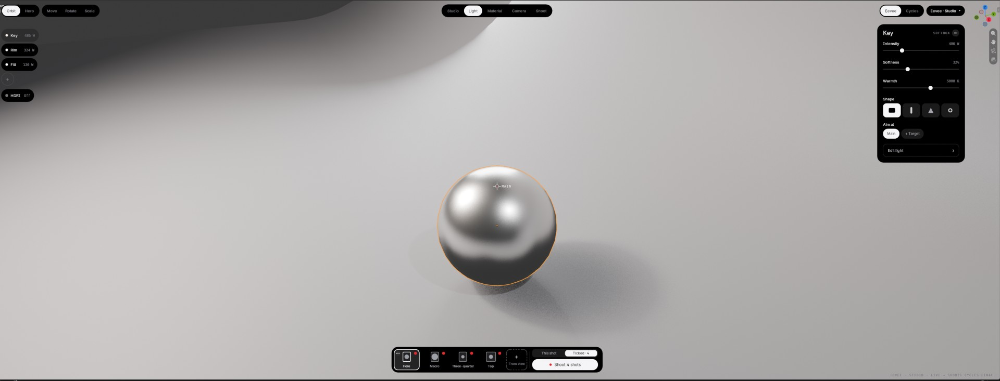
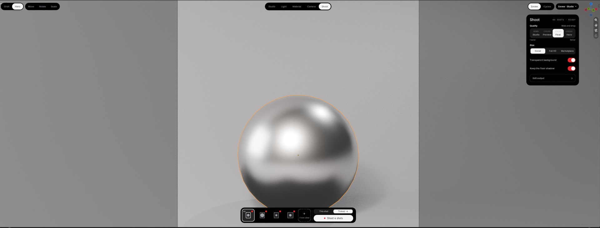

**Plinth turns Blender into a real-time rendering powerhouse for automotive and
bespoke work.** Select your model, click **Build Studio**, and the whole shoot is
set up around it.

Free, open source and fully offline. For Blender 4.2+ on Windows, macOS and Linux.

**[Download](https://github.com/Nosferatu-cc/plinth-blender/releases/latest)** ·
**[Join the Discord](https://discord.gg/MbMfjbNNwW)** ·
**[nosferatu.cc](https://nosferatu.cc)**


## A real-time studio, with nothing to sign in to

**5** plain steps · **20** studio looks · **100+** materials · **0** node trees

Select your model and click **Build Studio**. Plinth sets up the whole shoot
around it: a seamless backdrop, Key, Rim and Fill lights, and four ready-framed
shots, all sized to your model. From there the job is five plain steps:
**Studio · Light · Material · Camera · Shoot**.

You work live in Eevee, Plinth hands the final to Cycles or Eevee, and your scene
is left exactly as you found it. No jargon, no node trees, no setup tutorials,
no account.

## Made in Plinth

Testers' own work, captured in the viewport: paint, carbon, glass and lighting
from Plinth, no compositing.

| | |
|---|---|
|  |  |
|  |  |
|  |  |
|  |  |
|  |  |
|  |  |
|  |  |
|  |  |

## One model. Every spec.

Commissions, configurators, client sign-off: change the paint, the trim or the
wheels and shoot every angle again, without rebuilding a thing.

- **Paint to sample:** Base, Flip and Flake colours, or type the hex code. Solid,
  metallic, pearl, candy, matte, wrap and iridescent, with clearcoat and orange peel.
- **Liveries and badging:** decals and full liveries on any panel, carried across
  shut lines onto the next.
- **Interior trim:** Alcantara, Nappa, perforated leather, piano black, open-pore
  wood, and carbon in four weaves, mirrored across a bonnet's centre seam.
- **Wheels and brakes:** tread and sidewall fitted to each tyre; drilled, slotted
  or carbon-ceramic discs and calipers in any colour.
- **Save the spec:** keep a paint or a trim in *My library* and put it on any
  model, in any file, with one click.
- **Every angle, every time:** tick the shots once. Change the spec, press
  **Shoot**, and the whole set renders again.

**The same five steps work on anything you can model.** Watches, furniture,
motorcycles, packaging: Plinth builds a studio around whatever you select.
Automotive and bespoke work is where it's focused first.

## Five steps. That's the whole job.

- **Studio:** Build Studio and the shoot sets itself up. A seamless cove, corner,
  room, dome or endless floor, sized to your model, and twenty one-click looks
  (Car studio, Black gloss, Showroom, Dark luxe...). Or shoot somewhere else:
  procedural scenes, 3D sets and photo scenes.
- **Light:** Key, Rim and Fill in plain words. Click where you want a highlight
  and Plinth moves the light there. Real light types (Area as Softbox, Strip,
  Disc or Oval; Spot; Point; Sun), 13 gobos, HDRIs and a clear sky with a sun
  you drag across the viewport.
- **Material:** more than a hundred procedural materials with live 3D previews:
  paint, metal, glass, carbon, leather, fabric, tyres, brakes, wood, stone, glow
  and Vantablack. Search ("pearl", "windshield", "forged") and apply to one part
  or all four wheels at once. Your model's own texture sets come back
  automatically.
- **Camera:** Hero, Three-quarter, Top and Macro, plus your own. Five aspect
  ratios, perspective or orthographic, Front/Side/Rear/Top in one click, depth
  of field on a target, and a 360° turntable.
- **Shoot:** tick the shots, pick a quality (Eevee Studio, Eevee Final, Cycles
  Preview, Final, Hero) and shoot every angle in one go.

| | |
|---|---|
|  |  |
|  |  |

## Work in Eevee, shoot in Cycles

Eevee is tuned and measured against Cycles, so what you see live is what you
get. Cycles brings adaptive sampling, the best denoiser and real glass. Plinth
switches engine for you, and Shoot leaves your engine, camera, resolution and
frame exactly as they were.

Everything lives in its own Plinth workspace; the rest of your Blender setup is
untouched.

## Install

Needs **Blender 4.2 or newer** (developed and tested on Blender 5.2).

1. Download `plinth-<version>.zip` from
   [Releases](https://github.com/Nosferatu-cc/plinth-blender/releases/latest).
2. In Blender: **Edit › Preferences › Get Extensions › ▾ › Install from Disk…**
   and pick the zip.
3. In the 3D viewport, press **N**, open the **Plinth** tab and click
   **Open Plinth Studio**. Select your model and press **Build Studio**.

### Build it yourself

```
blender --command extension build --source-dir plinth --output-dir dist
```

(create `dist/` first), then install the zip from `dist/` as above.

## Community and help

- **Bugs and ideas:** [GitHub Issues](https://github.com/Nosferatu-cc/plinth-blender/issues).
  In Blender, **Preferences › Add-ons › Plinth › Help › Copy support info**
  copies your Plinth, Blender and system versions to paste into the issue.
- **Chat, previews and showing your shots:** [Discord](https://discord.gg/MbMfjbNNwW)
- **More from the author:** [nosferatu.cc](https://nosferatu.cc)
- **Contributing:** issues and pull requests welcome.
- **What changed in each version:** [CHANGELOG.md](CHANGELOG.md)

## Licence

Plinth's code is **GPL-3.0-or-later** (see [LICENSE](LICENSE)), as Blender
add-ons must be. Bundled assets keep their own licences:

- `plinth/assets/scenes/`: scanned texture maps from Poly Haven and ambientCG
  (CC0) and NASA imagery (public domain); see its `LICENSE.md`.
- `plinth/assets/udin/`: node groups adapted from the UDIN Shaders free pack
  (MIT); see its `LICENSE`.

Blender is a trademark of the Blender Foundation; Plinth is an independent
add-on for Blender.
