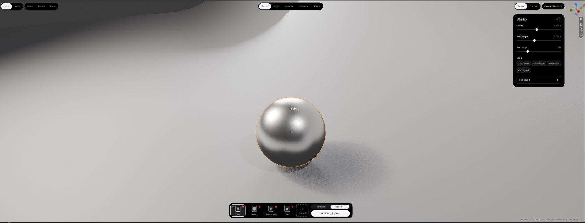
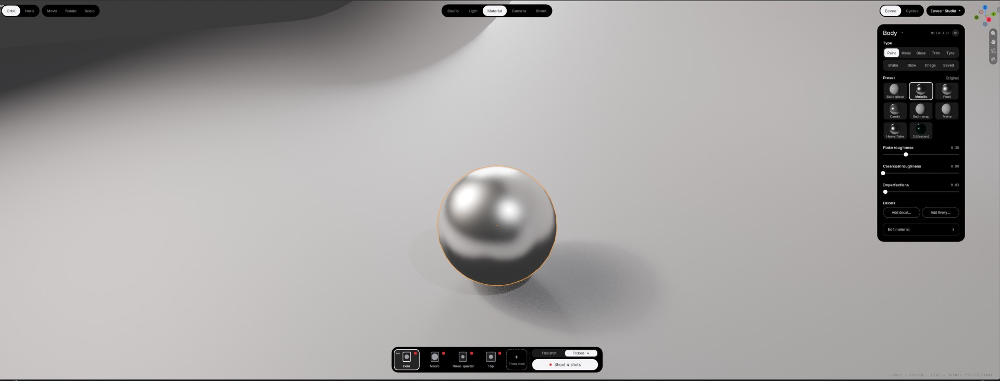
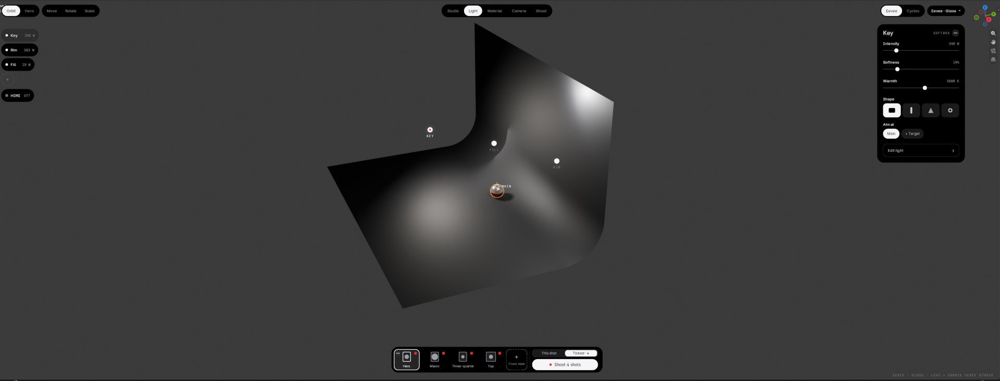
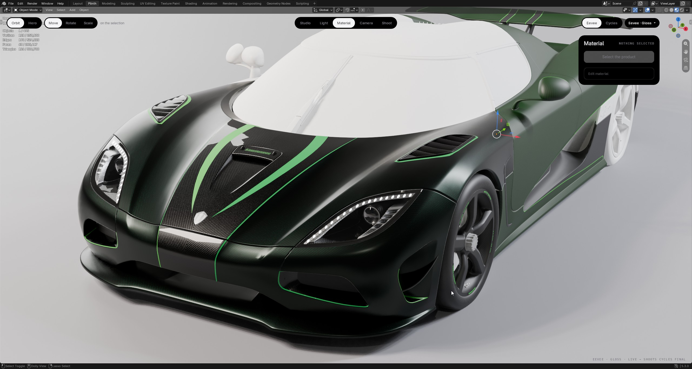
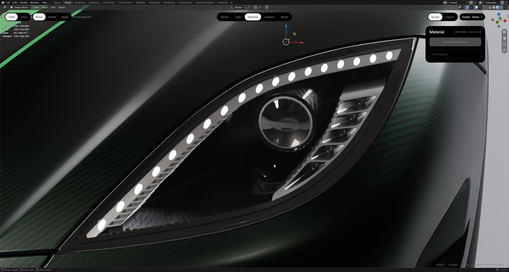
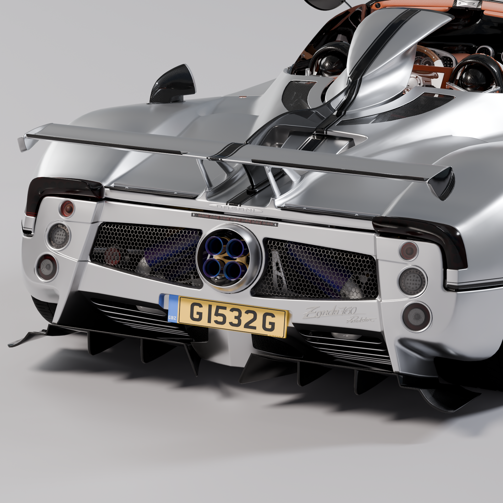
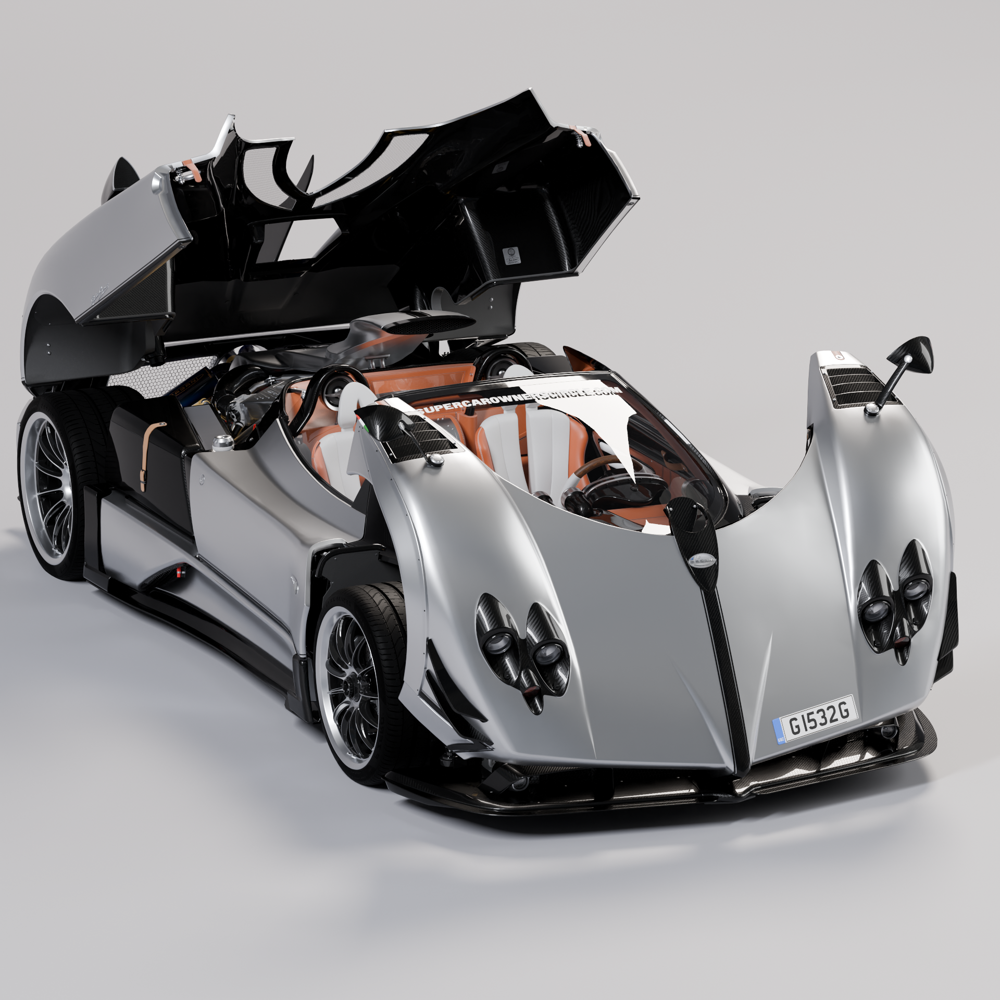
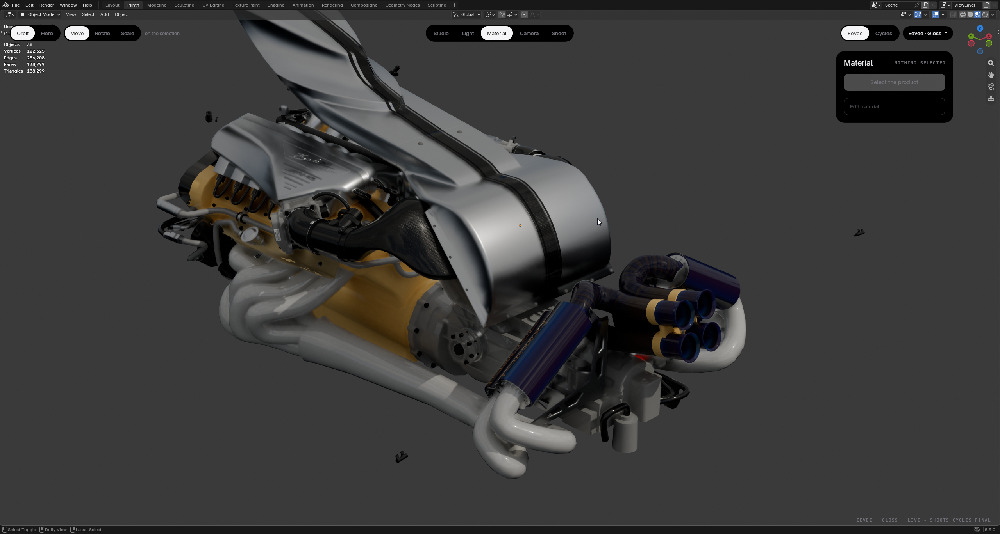

# Plinth

**A minimal product-photography studio for Blender.** Build a studio around
your product in one click, light it with plain-language controls, and shoot
every angle in one go. Work in Eevee for speed; shoot in Cycles for quality.



Plinth gets its own workspace: one big viewport with its controls floating
over it, in five steps: **Studio · Light · Material · Camera · Shoot**.
Your other workspaces stay exactly as they were, and after a shoot your scene
is put back the way it was.

## What it does

- **Studio:** a seamless cove, corner, room, dome or endless floor, sized to
  your product, with ready-made looks (Clean white, Car studio, Dark luxe…)
  and places to shoot in instead: procedural scenes, 3D sets and photo scenes.
- **Light:** a three-light rig with plain controls (Intensity, Softness,
  Warmth, Shape). Click the product where you want a highlight and Plinth
  moves the light there. Gobos and HDRIs too.
- **Material:** procedural automotive materials (paint, metal, glass, trim,
  carbon, tyres, brake discs, glow), Vantablack, decals and liveries, your
  model's own texture sets, and a library of materials you save once and
  reuse anywhere. Triplanar or UV mapping, with flip for mirrored carbon seams.
- **Camera:** ready-made shots (hero, three-quarter, macro, top), a shot bar,
  targets to aim at, and a turntable.
- **Shoot:** every shot in one click, in Eevee or Cycles, at social, Full HD
  or marketplace sizes, with a transparent background if you want one.

| | |
|---|---|
|  |  |
|  |  |

## Install

Needs **Blender 4.2 or newer** (developed and tested on Blender 5.2).

1. Download `plinth-<version>.zip` from
   [Releases](https://github.com/Nosferatu-cc/plinth-blender/releases).
2. In Blender: **Edit › Preferences › Get Extensions › ▾ › Install from Disk…**
   and pick the zip.
3. In the 3D viewport, press **N**, open the **Plinth** tab and click
   **Open Plinth Studio**. Select your product and press **Build studio**.

Plinth works fully offline: it never goes online and doesn't ask Blender for
network access.

### Build it yourself

```
blender --command extension build --source-dir plinth --output-dir dist
```

(create `dist/` first), then install the zip from `dist/` as above.

## Community Showcase
| | |
|---|---|
|  |  |
|  |  |
|  |  |
|  |  |
|  |  |
|  |  |
|  |  |
|  |  |

## Community and help

- **Bugs and ideas:** [GitHub Issues](https://github.com/Nosferatu-cc/plinth-blender/issues).
  In Blender, **Preferences › Add-ons › Plinth › Help › Copy support info**
  copies your Plinth, Blender and system versions to paste into the issue.
- **Chat, previews and showing your shots:** [Discord](https://discord.gg/MbMfjbNNwW)
- **More from the author:** [nosferatu.cc](https://nosferatu.cc)

What changed in each version: [CHANGELOG.md](CHANGELOG.md).

## Licence

Plinth's code is **GPL-3.0-or-later** (see [LICENSE](LICENSE)), as Blender
add-ons must be. Bundled assets keep their own licences:

- `plinth/assets/scenes/`: scanned texture maps from Poly Haven and ambientCG
  (CC0) and NASA imagery (public domain); see its `LICENSE.md`.
- `plinth/assets/udin/`: node groups adapted from the UDIN Shaders free pack
  (MIT); see its `LICENSE`.

Blender is a trademark of the Blender Foundation; Plinth is an independent
add-on for Blender.
